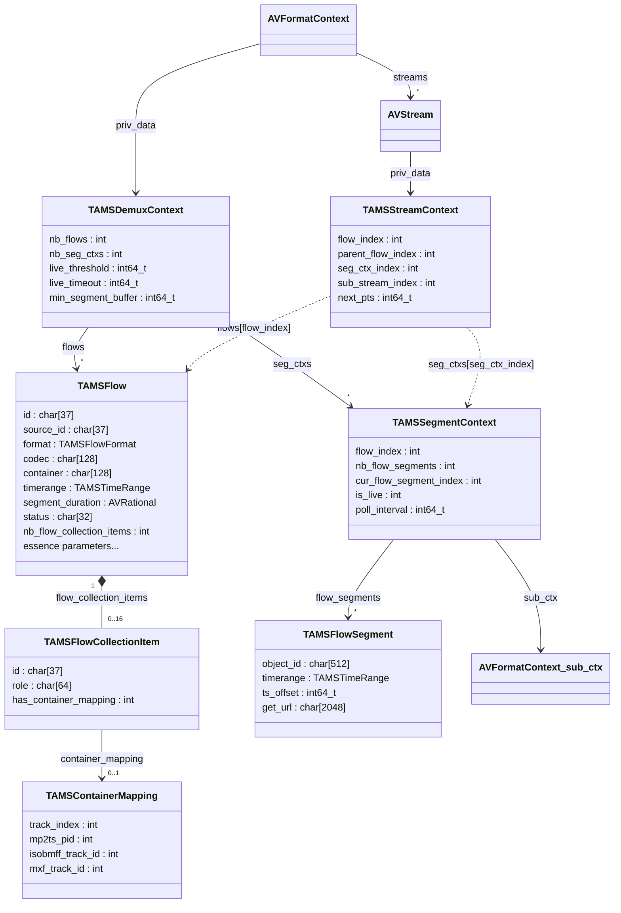
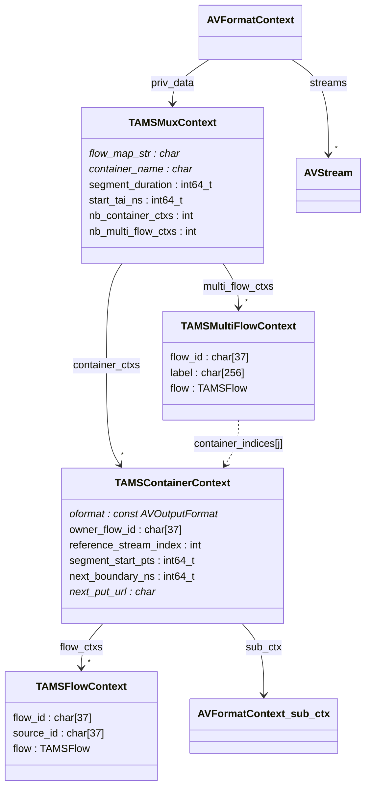
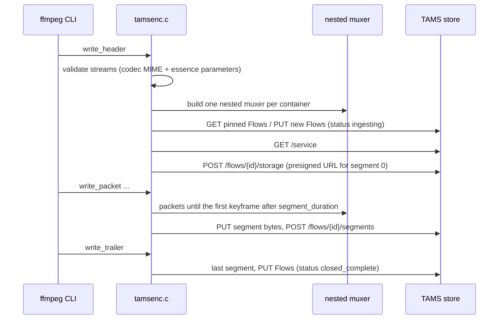

We have been working on adding support for the [Time-addressable Media Store](https://bbc.github.io/tams/) (TAMS) to FFmpeg: a demuxer that reads Flows and Sources from a TAMS store, and a muxer that writes to one, both live and non-live.

The work is available on the `tams` branch of our FFmpeg fork, as a patch series which we are preparing to submit upstream.

<!--more-->

### What is TAMS?

TAMS is an open API specification, started by BBC R&D and now developed with a growing group of broadcasters and vendors, for storing media in the cloud as small time-addressable chunks rather than as monolithic files.

The core concepts are:

* **Sources** - an abstract piece of content, e.g. "the camera 1 feed" or "episode 3"
* **Flows** - a concrete representation of a Source, e.g. "1080p H.264 at 8Mbps" or "stereo AAC"; Flows can be video, audio, data, image or *multi* (a collection of other Flows)
* **Segments** - Media Objects (a small MPEG-TS, MP4, raw elementary stream etc.) registered against a Flow for a given timerange
* **Timeranges** - everything is addressed on a nanosecond TAI timeline, e.g. `[1792591960:585251000_1792591966:585251000)`

Because media is stored as immutable, independently addressable segments on a shared timeline, it becomes possible to start working with content while it is still being recorded, to make edits by reference instead of by copy, and to share objects between Flows.

The API spec is here: [https://github.com/bbc/tams](https://github.com/bbc/tams), and AWS provide an open-source implementation: [https://github.com/aws-samples/time-addressable-media-store](https://github.com/aws-samples/time-addressable-media-store).

### Why FFmpeg?

A store is only useful if tools can get media in and out of it. Having TAMS supported natively in FFmpeg means anything which uses FFmpeg (ffmpeg, ffprobe, ffplay, and the many applications built on libavformat) can read from and write to a TAMS store simply by using a URL:

```shell script
ffmpeg -headers "Authorization: Bearer $TOKEN" \
  -i "https://tams.example.com/flows?source_id=<sourceId>" ...

ffmpeg -i INPUT -c:v libx264 -c:a aac \
  -flow_map "flow=streams=0,1,multi_flow=0" \
  -headers "Authorization: Bearer $TOKEN" \
  -f tams https://tams.example.com/flows
```

### The Branch

The code is on the `tams` branch here:

[https://github.com/hootworks/FFmpeg/tree/tams](https://github.com/hootworks/FFmpeg/tree/tams)

It is structured as three patches, as it would be submitted to the FFmpeg mailing list:

1. `avformat/tams`: shared code for the TAMS data model
2. `avformat`: the TAMS demuxer
3. `avformat`: the TAMS muxer

The main files are:

* `libavformat/tams.h` / `tams.c` - the TAMS data model (`TAMSFlow`, `TAMSFlowSegment`, `TAMSTimeRange`, `TAMSContainerMapping` etc.), parsing and serialising Flows, Segments and storage allocations to and from JSON, timestamp and timerange handling, codec MIME mapping, and HTTP requests with retry
* `libavformat/tamsdec.c` - the demuxer
* `libavformat/tamsenc.c` - the muxer
* `libavformat/tests/tams*.c` - unit tests, run as part of FATE
* `doc/demuxers.texi` / `doc/muxers.texi` - documentation

### Demuxer

The demuxer accepts either a single Flow (`/flows/<id>`) or all the Flows of a Source (`/flows?source_id=<id>`), optionally limited to a timerange. It creates one `AVStream` per video/audio/data Flow, expanding multi Flows into their members.

Each set of segments is read through a nested demuxer: a `TAMSSegmentContext` owns a child `AVFormatContext` which opens one segment at a time, with packets restamped from the segment's container timeline onto the Flow timeline. Where several Flows share one container (a multi Flow with a `container_mapping`) the segment context is shared and packets are routed back to the right stream by track index, MPEG-TS PID, ISOBMFF track id, or MXF track id.



### Muxer

The muxer writes each input `AVStream` to a Flow. By default every stream gets its own mono Flow, but the `-flow_map` option can group streams into a multi Flow sharing one container, or pin streams to existing Flows and Sources so that a new recording is appended to an existing timeline.

Each segment is produced by a nested muxer (raw elementary stream, MP4, MOV, MPEG-TS or Matroska), uploaded to a presigned storage URL obtained from the store, and then registered against the Flow with its timerange.



And the sequence of events when the muxer starts:



### Interesting Points

A few things which came up during the implementation and testing:

**No JSON library.** FFmpeg has no JSON parser dependency, so the JSON handling is a small cursor-based parser covering just the TAMS schemas, built on `AVBPrint`.

**Segments must be self-contained.** The first version of the muxer kept a single nested muxer running and simply swapped its output buffer at each segment boundary. That works for MPEG-TS, but not for MP4 (where the `moov` only appears at the end) or raw formats whose headers only appear once. The muxer now restarts the nested muxer for every segment, in the same way as FFmpeg's `segment` muxer.

**Segments are cut on keyframes, so timeranges must be too.** Segments can only start at a keyframe, so with x264's default GOP of 250 frames a 2 second `segment_duration` really means 10 second segments. Registering the *planned* boundary rather than the actual cut point meant most of each segment was discarded on playback. This was the cause of a stuttering live stream which kicked off the latest round of testing.

**`ts_offset` depends on the container.** TAMS defines `ts_offset` as the offset between the timestamps in the media and the Flow timeline. Raw elementary streams restart from zero in every segment, while MP4, MPEG-TS, Matroska and raw FLAC keep continuous timestamps (with their own shifts, e.g. MPEG-TS adds twice the mux delay). The muxer accounts for each case, and the demuxer infers the offset where a writer has omitted it.

**Following a live Flow.** A reader can't know whether a Flow is still being written just from its segments. TAMS 8.2 adds a Flow `status`, which the muxer sets to `ingesting` while writing and `closed_complete` when done. The demuxer follows it, falling back to timing heuristics (based on `segments_updated` and the observed segment length) for Flows without a status, or whose writer has disappeared.

**Segment boundaries in shared containers.** When video and audio share a container which is cut on a video keyframe, a few audio packets (and, with open GOP HEVC, a few leading pictures) belong to the *previous* segment's time but live in the next object. The demuxer keeps packets that follow on from what has already been delivered, rather than discarding everything outside the segment's timerange.

**Credentials.** Authentication uses standard FFmpeg `-headers`, and those headers are only replayed to the store's own host, never to the presigned storage URLs.

### What is Supported

* TAMS API version 8.2
* Demuxing a Flow or all Flows of a Source, optionally limited to a timerange, with seeking
* Live demuxing, including joining late, and ending when the writer closes the Flow or stops
* Video, audio, data (subtitle) and multi Flows; image Flows for demuxing
* Multi Flows with shared containers (`container_mapping`) or independent members
* Muxing to new Flows/Sources, or appending to existing Flows, Sources and multi Flows
* Video codecs: H.264, HEVC, VP8, VP9, AV1, MPEG-2, raw video
* Audio codecs: AAC, MP3, MP2, AC-3, E-AC-3, FLAC, Opus, Vorbis, PCM (16/24/32 bit)
* Subtitles: SubRip, WebVTT
* Containers: raw elementary streams, MP4, MOV, MPEG-TS, Matroska (plus MXF for demuxing)

### What is Not Supported (yet)

* Flows using separate initialisation segments (`init_object`, new in 8.2) - these are rejected with a clear error
* Flow profiles, webhooks, and Flow/Source tag and label editing beyond what is set at creation
* Obtaining or refreshing OAuth tokens: a bearer token must be supplied via `-headers`
* Muxing to MXF or Ogg (Ogg does not split cleanly into independent segments, so Vorbis uses Matroska)
* MP4 multi Flows containing AAC are placed about 21ms late on the Flow timeline (A/V sync is unaffected)

### Testing

The patches include unit tests for the JSON parsing, timestamp and timerange handling, the demuxer's segment and timestamp logic, and the muxer's `-flow_map` parsing, along with FATE tests demuxing TAMS samples, and the full FATE suite passes.

In addition, everything was tested end-to-end against a hosted instance of the AWS open-source TAMS implementation (API 8.2):

* Muxing a 6 second test source with each supported video and audio codec, then demuxing by Flow and by Source, checking every frame is present and timestamps are continuous
* Each container, multi Flows (shared and independent), and pinning to existing Flows, Sources and multi Flows, including appending a second recording to an existing timeline without a gap
* Timerange requests and seeking
* Live: muxing a 720p test source in real time while reading it back concurrently, by Flow and by Source, with different GOP sizes, containers and codecs, joining late, and with the muxer killed part way through
* Reading existing third-party content from the store
* Fuzzing the demuxer with damaged JSON

Not yet tested: MXF and image Flows (no test content), very long running live recordings, and stores other than the AWS implementation.

### Next Steps

The next step is to submit the patches to the FFmpeg development mailing list for review. If you are using TAMS and would like to try this out, or have content we could test against, please get in touch.
