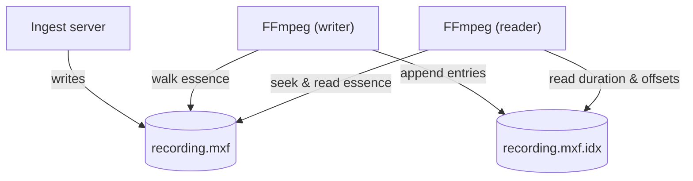
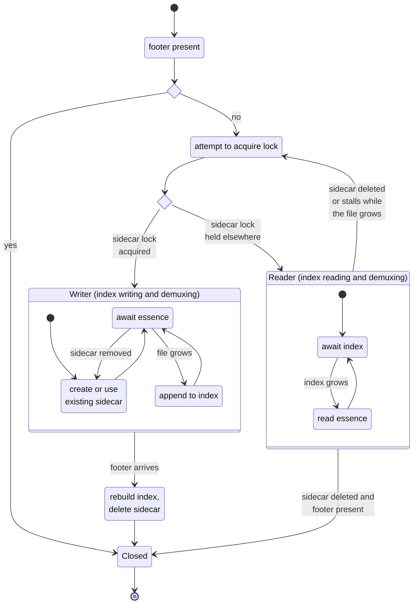

Growing files are a long-standing pattern in broadcast. An ingest server records a feed to shared storage as MXF, and while the recording is still in progress, other systems make use of it.

As part of recent work delivered for a client, we added support to FFmpeg's MXF demuxer for reading *growing* MXF files.
This lets anything built on FFmpeg start processing content while it is still being recorded, rather than waiting for the recording to finish.

<!--more-->

### Problems

When upstream FFmpeg opens an MXF file that is still being written, it reads the duration and index once and never updates them.
It demuxes until it reaches what it thinks was the end of the file and stops. If the writer was part-way through a KLV packet, the
last frame is truncated.

The file protocol's `-follow 1` option keeps it reading past the original end, but the MXF demuxer still never picks up the new index or duration, and the read never ends, even once the file is finished.

A growing MXF file has no footer yet, and usually no index table that FFmpeg can find when it opens the file, so seeking falls back to using average bit rate and is no longer frame accurate.

### Goal

Enhance the FFmpeg MXF demuxer implementation to be able to:

* open an MXF file that is still being written
* report a duration that grows as the file grows
* keep reading at the live edge as new essence arrives
* accurately seek anywhere in the file including into essence that arrives after the file was opened
* carry on seamlessly once writing is stopped and the file is closed

### Patch

The work is available here:

[https://github.com/dalet-oss/FFmpeg/commit/25bc782e89fcc2cedba7e0f603c331f0ae1ac5f5](https://github.com/dalet-oss/FFmpeg/commit/25bc782e89fcc2cedba7e0f603c331f0ae1ac5f5)

This patches `libavformat/mxfdec.c` to support demuxing of growing MXF files. The functionality is enabled by a new `growing_index_file` demuxer option:

```shell script
ffmpeg -growing_index_file /shared/recording.mxf.idx -i /shared/recording.mxf -c:v libx264 proxy.mp4
```

If the option isn't given, the demuxer behaves exactly as before.

### Sidecar Index

A growing MXF file has no usable index. Index table segments, if the writer produces them at all, typically arrive later, often only in the footer. Without an index, the only way to know how the latest duration, or where a particular frame starts, is to walk the essence from the start.

That is fine for one process, but not when several processes are reading the same growing file. Each would walk the same essence independently, and a simple question such as "what is the current duration?" becomes expensive.

The patch introduces a small binary sidecar index file next to the MXF file. It has a fixed-size header containing the current duration in edit units, which can be read in constant time, followed by one entry per edit unit of the reference track with its offset and size.

For MPEG-2 and H.264 the index file also records each frame's temporal offset, derived from the elementary stream, so that the reordering of frames into presentation order works without waiting for the container index.

The index file is useful in its own right: any other process (not just FFmpeg) can read the header to find how much of the recording is available.

### Index Writer and Index Readers

Exactly one FFmpeg process (or other libavformat-based application) maintains the sidecar. Every process which opens the growing file with the same `growing_index_file` takes one of two roles:

* **writer**: holds a lock on the sidecar, walks the essence as it arrives and appends to the sidecar
* **reader**: trusts the sidecar and never walks the essence



**Changing Roles**

The roles are not fixed due to the fact that processes may come and go. If the writer goes away, the sidecar stops advancing while the MXF file keeps growing. A reader which notices this takes over as the writer. If the sidecar disappears, it is recreated. Once the writer has indexed all the way to the footer, it deletes the sidecar, which is the signal to all the readers that the file is complete.

**Writers are still Demuxers**

A writer isn't a separate indexing process. It is an ordinary FFmpeg process,
transcoding or playing the file like any reader. But it happens to hold the writer lock and therefore takes responsibility for writing the index file.
A writer builds the index as a side effect of its own demuxing: each time it reads an edit unit of the reference track, it appends an entry to the sidecar.

A writer's reading and seeking use the same index file:

* Reading forward from the end of the index extends it as each packet is read.
* Seeking backwards into essence it has already indexed involves a lookup in its
own index. When it reads forward again, it skips entries
that are already in the index and starts appending again once it passes the last one.
* Seeking forwards past the end of the index, means there is no index entry to look up.
Instead, the writer reads forward from where it is, indexing as it goes,
until the target is covered, and then seeks to it. This is also how a writer
waits for a target beyond the live edge.



### Dedicated Writer

There are two caveats to the implemented functionality:

* Because the index is only built where the writer has read, the sidecar advances
  at the writer's pace, not the file's. A reader can never get ahead of the writer's
  indexing. A writer that is slow (for example a realtime encode), holds readers
  back. Readers don't treat this as a stall as a writer which is still alive keeps its
  lock and the readers wait for it. A reader only takes over once the sidecar stops
  advancing altogether and the lock is released (because the writer has exited or crashed).

* A new writer resumes from the last entry in the sidecar, so the index stays dense. The exception is a process which becomes the writer when it opens the file and then immediately seeks beyond the end of the index. (This is only possible for frame-wrapped constant bit rate essence, where positions can be calculated). In this case writer logs a warning and gives up the writer role rather than leave a gap in the index.

Due to these two points, if the use case is to support multiple readers seeking at different points
into the growing file it makes sense to start a single initial process acting as the writer
when the recording starts and to keep it reading near the live edge e.g. an ffprobe dumping packets. This ensures that an index file covering the entire recording up to the live edge will be available for use by other processes e.g. for rendering or playout. 


### Further Details

**Static File Assumption**

Several parts of the MXF demuxer determine values such as the duration, the essence length and the index duration when the file is opened, and later clamp against them. These have to be kept up to date as the file grows, and kept consistent with each other.

**Growing Indicator**

It is tempting to look at the header partition status, as MXF has a notion of "open" and "closed" partitions.

In practice this isn't a reliable indicator. Live writers, including FFmpeg's own MXF muxer, keep an open header partition for the whole time they are
writing. FFmpeg only marks the header closed at the very end, after writing the footer, and only if it can seek back to the start of the output. Therefore a finished file can sometimes still have an open header.

 Instead, a file is treated as growing only while it has no footer partition. If a footer is already there when the file is opened, it is treated as a closed file.

**Single Reference Track**

An MXF file can carry many tracks, each with its own edit rate, each wrapped in different ways. To keep things manageable, every position and duration is expressed in edit units of a single reference track which is the first video track or else the first audio track.

**Blocking Read**

When the reader catches up with the writer, rather than returning EOF it waits for the file to grow, and resumes when it does. It gives up only when:

* the writer finishes the file
* an optional timeout without any growth is reached
* the caller interrupts it

**EOF != Error**

At the live edge, the end of the file can fall anywhere, including in the middle of a 16 byte KLV key or a BER encoded length. Previously some of these cases decoded as a zero length or as invalid data. They are now recognised as "not written yet" and retried.

**Whole Packets**

A growing file almost always ends part way through an edit unit. The KLV key and length arrive before the payload arrives.
So the reader only returns a packet once all of its bytes are present.

**Frame Wrapping and Clip Wrapping**

In frame-wrapped essence, each edit unit is its own KLV. In clip-wrapped essence, a single KLV covers the entire essence. Therefore its length (as written by a live writer) has little relation to what is actually readable.

**CBR and VBR**

For CBR essence, the position of any edit unit can be calculated from the stride, which the writer measures from the first few edit units. For VBR essence, the only way to find an edit unit is the dense index in the sidecar.

**Frame Reordering**

For long-GOP codecs, presentation timestamps depend on the temporal offsets in the container's index which a growing file doesn't have until an index segment is written. For MPEG-2 and H.264 the offsets are derived from the elementary stream as it is indexed. For other long-GOP codecs (such as HEVC) the writer holds back from appending index entries beyond what a published index segment covers. This costs up to one GOP of latency, but ensures the index is always correct.

**Reliable End Detection**

Finishing an MXF file takes several writes (the footer, the Random Index Pack and then updating the header) and the demuxer can look at the file between any of them. The demuxer only treats the file as complete once it has confirmed a footer partition is really there, so that a half-written index pack or header is never mistaken for the end. It also ensures that essence bytes which happen to look like MXF keys are never mistaken for a footer.

**File Completion Handling**

When the footer arrives, the demuxer rebuilds its index from the footer's index table segments and continues exactly as it would for a closed file.    

---

### Need Help?

Growing file workflows are common in broadcast and media production, and the details are rarely the same twice.
If you need FFmpeg, or any other part of your media pipeline, to do something it doesn't do out of the box, whether that is reading growing files, integrating a proprietary SDK, or supporting a new standard, please [make contact](/contact/).
