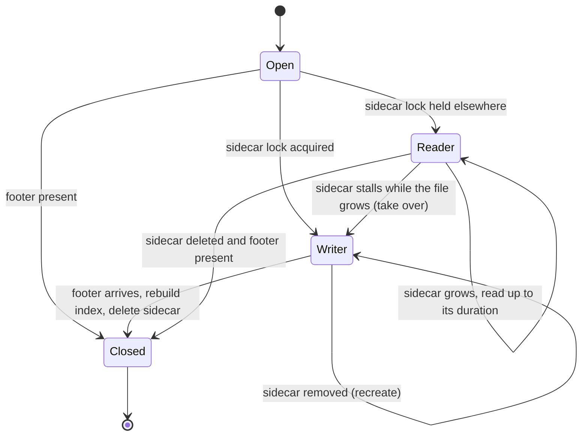
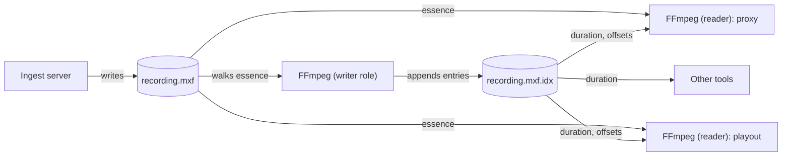

As part of recent work delivered for a client, we added support to FFmpeg's MXF demuxer for reading *growing* MXF files: files which are still being written by another process, such as an ingest server recording a live feed.

This lets anything built on FFmpeg start working with content while it is still being recorded, rather than waiting for the recording to finish.

<!--more-->

### Goal

Growing files are a long-standing pattern in broadcast. An ingest server records a feed to shared storage as MXF, and while the recording is still in progress, other systems want to use it: an editor wants to start cutting, a proxy generator wants to transcode, a QC tool wants to analyse, a playout system wants to play it out.

Out of the box, FFmpeg treats an MXF file as a finished thing. When opening a file that is still being written it sees a duration which is frozen at whatever was present when it was opened, it reaches what looks like the end of the file and stops, and it can't seek beyond the point it first saw. Often it simply fails, because the end of the file is in the middle of a KLV packet.

The goal was for a reader to be able to:

* open an MXF file that is still being written
* report a duration that grows as the file grows
* keep reading as new essence arrives, rather than stopping at the current end of the file
* seek anywhere within what has been written so far, including into content that arrives after the file was opened
* carry on seamlessly as a normal closed file once the recording finishes

### The Patch

The work is available here:

[https://github.com/dalet-oss/FFmpeg/commit/25bc782e89fcc2cedba7e0f603c331f0ae1ac5f5](https://github.com/dalet-oss/FFmpeg/commit/25bc782e89fcc2cedba7e0f603c331f0ae1ac5f5)

It is a single change to `libavformat/mxfdec.c`, enabled by a new `growing_index_file` demuxer option:

```shell script
ffmpeg -growing_index_file /shared/recording.mxf.idx \
  -i /shared/recording.mxf -c:v libx264 proxy.mp4
```

If the option isn't given, the demuxer behaves exactly as before.

### Approach

**What makes a file growing?** It is tempting to look at the header partition status, as MXF has a notion of "open" and "closed" partitions. In practice this isn't a reliable indicator: live writers, including FFmpeg's own MXF muxer, keep an open header partition for the whole life of the file. Instead, a file is treated as growing only while it has **no footer partition**. If a footer is already there when the file is opened, it is opened as a normal closed file.

**A single reference track.** An MXF file can carry many tracks, each with its own edit rate, wrapped in different ways. To keep things manageable, every position and duration is expressed in edit units of a single reference track: the first video track, or else the first audio track.

**Block instead of EOF.** When the reader catches up with the writer, rather than returning end of file it waits for the file to grow, and resumes when it does. It gives up only when the writer finishes the file, when an optional timeout without any growth is reached, or when the caller interrupts it.

**Wait for whole packets.** A growing file almost always ends part way through an edit unit. The KLV key and length arrive before the payload, so a naive reader happily returns a truncated frame. The reader only returns a packet once all of its bytes are present.

**Switch to closed-file behaviour at the end.** When the footer arrives, the demuxer rebuilds its index from the footer's index table segments and continues exactly as it would for a closed file.

### The Sidecar Index

A growing MXF file has no usable index: the index table segments, if the writer produces them at all, typically arrive later, often only in the footer. Without an index, the only way to know how far a file has really got, or where a particular frame starts, is to walk the essence from the start.

That is fine for one process, but not when several processes are reading the same growing file. Each would walk the same essence independently, and a simple question such as "what is the current duration?" becomes expensive.

So the patch introduces a small binary **sidecar index** file next to the MXF file. It has a fixed-size header containing the current duration in edit units, which can be read in constant time, followed by one entry per edit unit of the reference track with its offset and size. For MPEG-2 and H.264 it also records each frame's temporal offset, derived from the elementary stream, so that the reordering of frames into presentation order works without waiting for the container index.

The sidecar is a useful interface in its own right: any other process (not just FFmpeg) can read the header to find how much of the recording is available.

### Writer and Readers

Exactly one process maintains the sidecar. Every process which opens the growing file with the same `growing_index_file` takes one of two roles:

* the **writer** holds a lock on the sidecar, walks the essence as it arrives and appends to the sidecar
* every other process is a **reader**, which trusts the sidecar and never walks the essence itself

The roles are not fixed. Processes come and go: an editor closes the file, a transcode finishes, someone kills a process. If the writer goes away, the sidecar stops advancing while the MXF file keeps growing, and a reader which notices this takes over as the writer. If the sidecar disappears, it is recreated. Once the writer has indexed all the way to the footer, it deletes the sidecar, which is the signal to all the readers that the file is complete.



Putting it all together, a typical deployment looks like this:



### Challenges

A few of the things which made this harder than it first appears:

**FFmpeg assumes files don't change.** Several parts of the MXF demuxer latch values such as the duration, the essence length and the index duration when the file is opened, and later clamp against them. Seeking past the duration seen at open time failed even when the essence was there. These have to be kept up to date as the file grows, and kept consistent with each other.

**End of file isn't an error any more.** At the live edge, the end of the file can fall anywhere, including in the middle of a 16 byte KLV key or a BER encoded length. Previously some of these cases decoded as a zero length, or as invalid data. They now need to be recognised as "not written yet" and retried, which is subtle because the writer can append the missing bytes at any moment, including between two checks.

**Frame wrapping and clip wrapping.** In frame-wrapped essence, each edit unit is its own KLV. In clip-wrapped essence, a single KLV covers the entire essence, so its length (as written by a live writer) bears little relation to what is actually on disk. The waiting logic has to work on the byte range of the edit unit being read, not the KLV.

**Constant and variable bit rate.** For constant bit rate essence, the position of any edit unit can be calculated from the stride, which the writer measures from the first few edit units. For variable bit rate essence, the only way to find an edit unit is the dense index in the sidecar.

**Frame reordering.** For long-GOP codecs, presentation timestamps depend on the temporal offsets in the container's index, which a growing file doesn't have yet. For MPEG-2 and H.264 these are derived from the elementary stream as it is indexed. For other long-GOP codecs such as HEVC, the reader holds back from delivering beyond what a published index segment covers: this costs up to one GOP of latency, but is always correct.

**Seeking to the future.** A seek to a point beyond the live edge doesn't fail or clamp, it waits until that point has been written. This is what lets, for example, a player jump to "nearly live".

**Detecting the end reliably.** The footer has to be detected without false positives from essence bytes which happen to look like MXF keys, and without being confused by a writer which is part way through finalising the file.

### Get in Touch

Growing file workflows come up again and again in broadcast and media production, and the details are rarely the same twice: different writers, wrappings, codecs and storage systems all bring their own quirks.

If you need FFmpeg, or any other part of your media pipeline, to do something it doesn't do out of the box, whether that is reading growing files, integrating a proprietary SDK, or supporting a new standard such as [TAMS](/news/ffmpeg-tams-support/), please [get in touch](/contact/).
