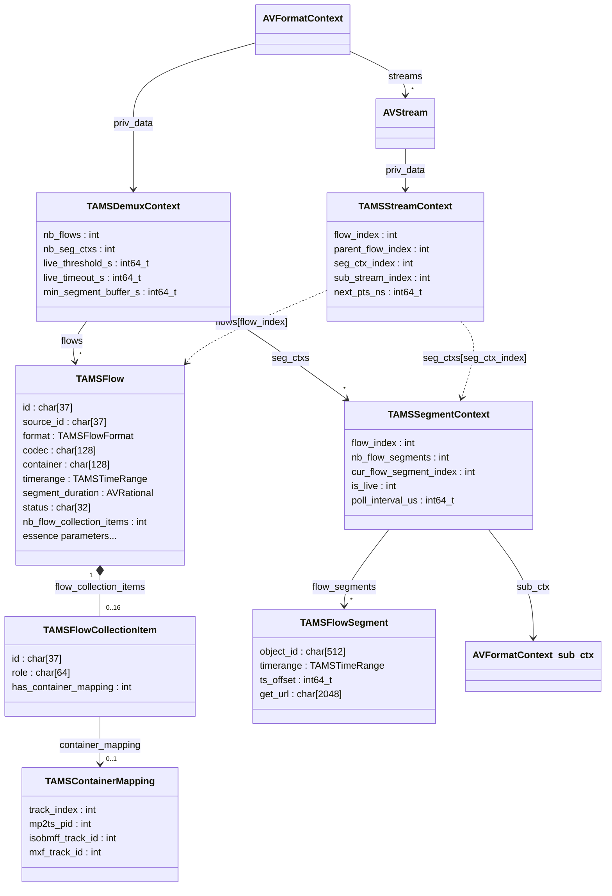
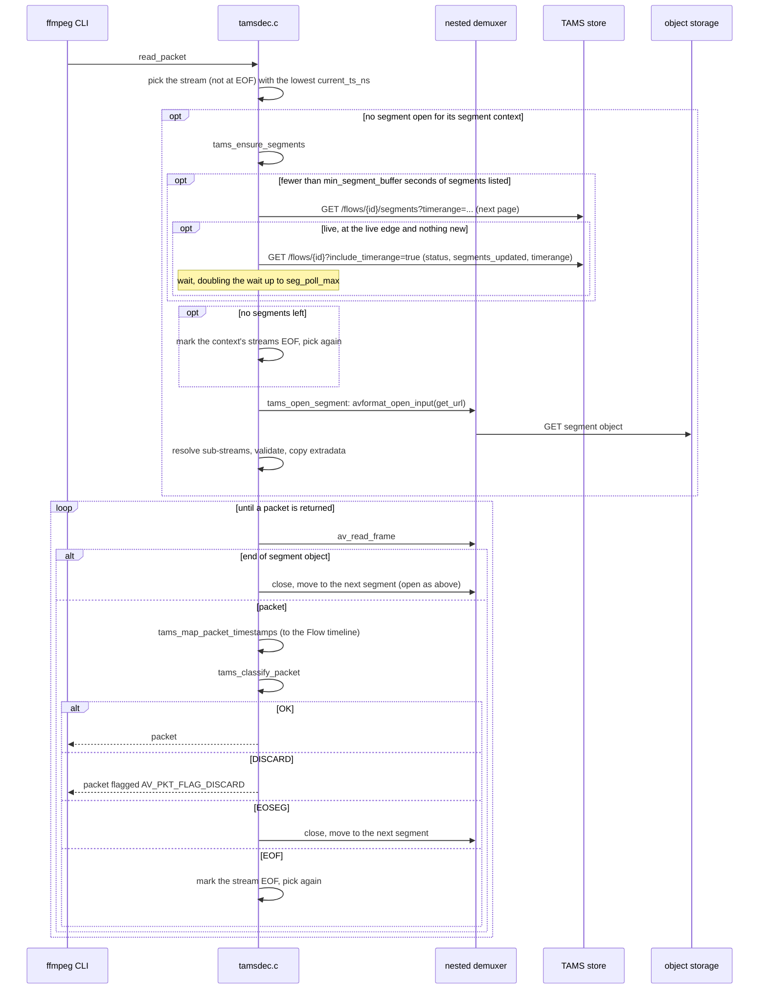
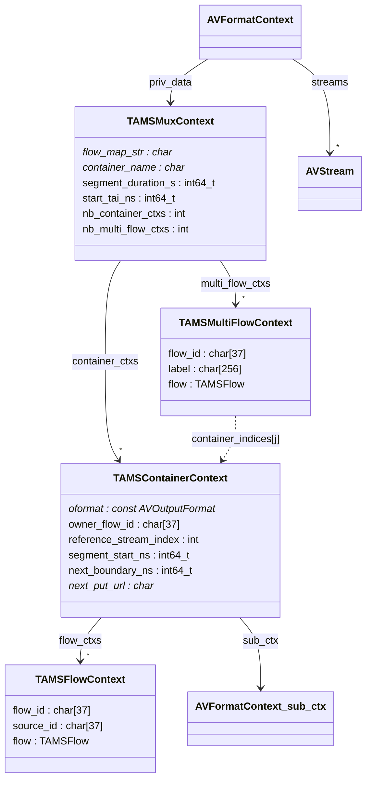
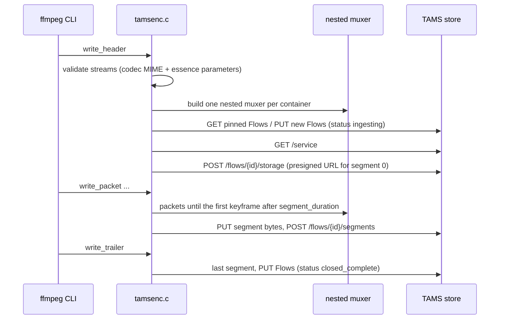
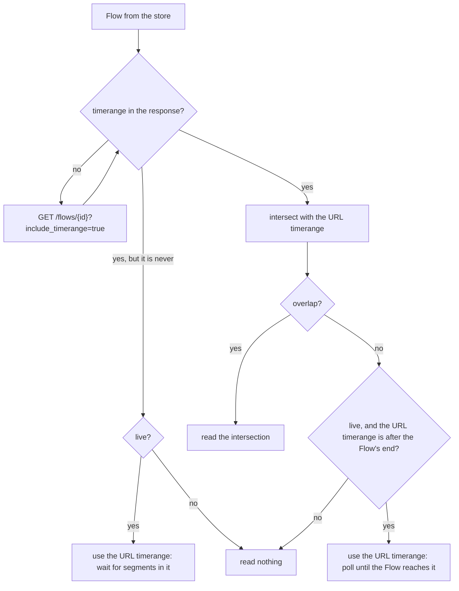

I have been working on adding support for the [Time-Addressable Media Store](https://tams.org) (TAMS) to FFmpeg. This includes:

* a demuxer that reads Flows, Multi Flows and Sources from a TAMS store
* a muxer that writes one of more Flows or Multi-Flows to a TAMS store

Both live and non-live Flows are supported.

The work is available on the [`tams` branch](https://github.com/hootworks/FFmpeg/tree/tams) of our FFmpeg fork as a series of three patches which is being prepared to submit upstream.

<!--more-->

### TAMS Overview

TAMS is an open API specification, started by BBC R&D and now developed with a growing group of broadcasters and vendors.
It defines storage of media in the cloud as small time-addressable chunks rather than as monolithic files. The core concepts are:

* **Sources**: an abstract piece of content, e.g. "the camera 1 feed" or "episode 3"
* **Flows**: a concrete representation of a Source, e.g. "1080p H.264 at 8Mbps" or "stereo AAC". Flows can be video, audio, data, image or *multi* (a collection of other Flows)
* **Segments**: Media Objects (a small MPEG-TS, MP4, raw elementary stream etc.) registered against a Flow for a given timerange
* **Time Ranges**: everything is addressed on a nanosecond TAI timeline, e.g. `[1792591960:585251000_1792591966:585251000)`

Because media is stored as immutable, independently addressable segments on a shared timeline, it becomes possible to start working with content while it is still being recorded, to make edits by reference instead of by copy, and to share objects between Flows.

The API spec is here: [https://github.com/bbc/tams](https://github.com/bbc/tams).

However, a store is only useful if tools can get media in and out of it. Having TAMS supported natively in FFmpeg means anything which uses FFmpeg (ffmpeg, ffprobe, ffplay or any application built on libavformat) can read from and write to a TAMS store.

### Demuxer Usage

The demuxer is selected automatically from the store's `/flows` URL. The examples below assume a store at `$TAMS` and a bearer token in `$TOKEN`:

```shell script
TAMS=https://tams.example.com
AUTH="Authorization: Bearer $TOKEN"
```

**Inspect a Flow.** ffprobe reports the Flow's streams and duration without downloading the whole Flow:

```shell script
ffprobe -headers "$AUTH" -show_streams -show_format "$TAMS/flows/<flowId>"
```

**Export a Source to a file.** Reading by `source_id` opens the Flows of the Source as the streams of one input, aligned on the shared TAI timeline. Here the first video and audio Flows are copied into a single MP4 without re-encoding:

```shell script
ffmpeg -headers "$AUTH" -i "$TAMS/flows?source_id=<sourceId>" \
  -map 0:v:0 -map 0:a:0 -c copy programme.mp4
```

**Clip a timerange.** A `timerange` in the URL limits the read to that window. Only the segments which overlap it are fetched. When the start falls part way through a GOP, the packets from the preceding keyframe are still read, as they are needed to decode the first frames. With stream copy, as here, they are kept, so the clip starts at that keyframe, slightly before the requested start. When re-encoding, they are decoded and then dropped, so the output starts exactly at the start of the timerange:

```shell script
ffmpeg -headers "$AUTH" \
  -i "$TAMS/flows/<flowId>?timerange=[1792591960:0_1792591990:0)" \
  -c copy clip.mp4
```

**Seek within a Flow.** Standard `-ss` and `-t` work as for any seekable input. Here a 10 second proxy is made starting 2 minutes in:

```shell script
ffmpeg -headers "$AUTH" -ss 120 -t 10 -i "$TAMS/flows/<flowId>" \
  -vf scale=640:-2 -c:v libx264 -c:a aac proxy.mp4
```

**Watch a live Flow.** A Flow which is still `ingesting` is followed as new segments are registered, so it can be played, or processed, while it is being recorded. Reading ends when the Flow is marked `closed_complete`, or when no new segments arrive within `live_timeout`:

```shell script
ffplay -headers "$AUTH" "$TAMS/flows/<flowId>"
```

**Join a live Source from a point in time.** Combining a Source with a timerange that is open at the end starts at that point and then keeps following the live edge. Here a recording that is still in progress is transcoded from a given time onwards, with a 30 second timeout to tolerate a stalled ingest:

```shell script
ffmpeg -headers "$AUTH" -live_timeout 30 \
  -i "$TAMS/flows?source_id=<sourceId>&timerange=[1792591960:0_)" \
  -c:v libx264 -c:a aac -f mpegts udp://239.0.0.1:1234
```

### Muxer Usage

The muxer is selected with `-f tams`, and its output URL is always the store's `/flows` endpoint. How the streams map to Flows is set with `-flow_map`.

**One Flow per stream.** Without `-flow_map`, each stream becomes its own mono Flow, under a new Source, in a raw elementary stream where one exists (here H.264 and AAC ADTS). A Flow's label and description are set from the stream's `title` and `comment` metadata, and any other metadata becomes a Flow tag:

```shell script
ffmpeg -i interview.mov -c:v libx264 -g 50 -c:a aac \
  -metadata:s:v:0 title="Interview camera 1" \
  -metadata:s:a:0 title="Interview audio" -metadata:s:a:0 language=eng \
  -headers "$AUTH" -f tams "$TAMS/flows"
```

**A multi Flow with a shared container.** Mapping video and audio to one `flow=` token writes them into one container (MP4 by default), registered as a multi Flow with a video and an audio Flow in its `flow_collection`. The multi Flow's own label and tags are set on its `multi_flow=` token:

```shell script
ffmpeg -i episode3.mxf -c:v libx264 -g 50 -c:a aac \
  -flow_map "flow=streams=0,1,multi_flow=0 multi_flow=0,label=Episode3,tags.series=Gardening" \
  -headers "$AUTH" -f tams "$TAMS/flows"
```

**Live ingest.** Any live input can be recorded into the store as it arrives. The Flows are `ingesting` while the muxer runs, so readers can follow them live, and are marked `closed_complete` when it finishes. Segments are cut on the first keyframe after `segment_duration`, so the GOP should match it. Here an SRT feed is recorded as MPEG-TS segments of 2 seconds (50 frames at 25 fps):

```shell script
ffmpeg -i "srt://0.0.0.0:9000?mode=listener" \
  -c:v libx264 -g 50 -keyint_min 50 -c:a aac \
  -flow_map "flow=streams=0,1,multi_flow=0" \
  -container mpegts -segment_duration 2 \
  -headers "$AUTH" -f tams "$TAMS/flows"
```

**Upload an existing file without re-encoding.** Stream copy works too. Segments can only start on a keyframe, so with stream copy the input's GOP decides the segment length: a GOP longer than `segment_duration` gives longer segments:

```shell script
ffmpeg -i archive.mp4 -map 0:v -map 0:a -c copy \
  -flow_map "flow=streams=0,1,multi_flow=0" \
  -headers "$AUTH" -f tams "$TAMS/flows"
```

**Add a new rendition to an existing Source.** Setting `source_id=` adds a new Flow to an existing Source rather than creating a new one. Here a Flow is read from the store, transcoded and written back as a lower bitrate proxy of the same Source. Setting `-start_timestamp` to the start of the original Flow's timerange places the proxy on the same part of the timeline as the original:

```shell script
START=$(curl -s -H "$AUTH" "$TAMS/flows/<flowId>?include_timerange=true" \
  | jq -r '.timerange | capture("^[\\[(]?(?<start>[0-9:]+)").start')
ffmpeg -headers "$AUTH" -i "$TAMS/flows/<flowId>" \
  -map 0:v -vf scale=640:-2 -c:v libx264 -b:v 1M -g 50 \
  -metadata:s:v:0 title="Proxy 360p" \
  -flow_map "flow=streams=0,source_id=<sourceId>" \
  -start_timestamp "$START" \
  -headers "$AUTH" -f tams "$TAMS/flows"
```

**Append to an existing Flow.** Setting `id=` pins a stream to an existing Flow, and the stream's codec and essence parameters are checked against the Flow's rather than overwriting them. Setting `-start_timestamp` to the end of the Flow's current timerange continues its timeline without a gap. Here a second recording is appended to an existing multi Flow, whose member Flows are found in its `flow_collection`:

```shell script
END=$(curl -s -H "$AUTH" "$TAMS/flows/<multiFlowId>?include_timerange=true" \
  | jq -r '.timerange | capture("_(?<end>[0-9:]+)").end')
ffmpeg -i part2.mp4 -c:v libx264 -g 50 -c:a aac \
  -flow_map "flow=streams=0,1,multi_flow=0 multi_flow=0,id=<multiFlowId>" \
  -start_timestamp "$END" \
  -headers "$AUTH" -f tams "$TAMS/flows"
```

### Implementation Details

The code is on the `tams` branch here:

[https://github.com/hootworks/FFmpeg/tree/tams](https://github.com/hootworks/FFmpeg/tree/tams)

and is structured as three patch commits as would be submitted to the FFmpeg mailing list:

1. shared code for the TAMS data model and utility functions
2. the TAMS demuxer
3. the TAMS muxer

The main files are:

* `libavformat/tams.h` and `tams.c`: the TAMS data model, support for parsing and serialising Flows, Segments and storage allocations to and from JSON, timestamp and timerange handling, codec MIME mapping and HTTP requests with retry
* `libavformat/tamsdec.c`: the demuxer
* `libavformat/tamsenc.c`: the muxer
* `libavformat/tests/tams*.c`: unit tests, run as part of FATE
* `doc/demuxers.texi` and `doc/muxers.texi`: documentation

#### Demuxer

The demuxer accepts either a single Flow (`/flows/<id>`) or all the Flows of a Source (`/flows?source_id=<id>`), optionally limited to a timerange. It creates one `AVStream` per video/audio/data Flow, expanding multi Flows into their members.

Each set of segments is read through a nested demuxer: a `TAMSSegmentContext` owns a child `AVFormatContext` which opens one segment at a time, with packet timestamps mapped from the segment's container timeline onto the Flow timeline. Where several Flows share one container (a multi Flow with a `container_mapping`) the segment context is shared and packets are routed back to the right stream by track index, MPEG-TS PID, ISOBMFF track id, or MXF track id.



And the sequence of calls each time the caller asks the demuxer for a packet (`tams_read_packet`):



#### Muxer

The muxer writes each input `AVStream` to a Flow. By default every stream gets its own mono Flow, but the `-flow_map` option can group streams into a multi Flow sharing one container, or pin streams to existing Flows and Sources so that a new recording is appended to an existing timeline.

Each segment is produced by a nested muxer (raw elementary stream, MP4, MOV, MPEG-TS or Matroska), uploaded to a presigned storage URL obtained from the store, and then registered against the Flow with its timerange.



And the sequence of events when the muxer starts:



#### Timeranges

Timeranges turned out to need more care than expected, so it is worth describing how the demuxer handles them.

**The forms.** A TAMS timerange is `[start_end)` with `[`/`]` inclusive and `(`/`)` exclusive markers, and either end may be missing. There are also some special forms:

| Form | Meaning | Written by FFmpeg as |
|------|---------|----------------------|
| `[5:0_10:0)` | from 5 s up to (not including) 10 s | `[5:0_10:0)` |
| `[5:0_)` | from 5 s onwards | `[5:0_)` |
| `_` | eternity: all time | `(_)` |
| `[5:0]` | instantaneous: exactly 5 s | `[5:0_5:0]` |
| `()` | never: the empty range | `()` |

`TAMSTimeRange` keeps a separate `never` flag rather than encoding the empty range as some start and end, so "empty" and "unbounded" can't be confused. `ff_tams_timerange_intersect()` takes the later start and the earlier end, with each end inclusive only if both ranges include it, and gives never if the ranges do not overlap.

**A Flow's timerange isn't always in the response.** The spec only returns a Flow's timerange from `GET /flows/{id}` when `include_timerange=true` is given, and `GET /flows` has no way to ask for it at all. The demuxer can't change the first request (FFmpeg opens the URL and probes the response before the demuxer is chosen), so for a Flow without a timerange it makes a second request with `include_timerange=true`. A Flow without a timerange in the response is different from one whose timerange is `()`: the first is unknown, the second means the Flow has no segments yet, e.g. a live Flow which has just been created. A multi Flow whose media is all in its members' containers is also always `()`.

**Limiting a read to a timerange.** A `timerange=` in the opened URL limits what is read. It means different things to the store depending on the URL:

* on `/flows/{id}` it only limits the timerange returned for the Flow (and only when `include_timerange=true` is also given)
* on `/flows?source_id=...` it only filters which Flows are returned, so a Flow which overlaps the range at all is returned with its full timerange. A multi Flow's own `()` never overlaps, so its members need to be asked for by `/flows/{id}`

So the demuxer applies the URL's timerange itself. Each Flow's timerange, as given by the store, is narrowed to its intersection with the URL's. This is done for the Flows in the first response, for Flows fetched to find their timerange, for multi Flow members fetched afterwards, and again whenever a live Flow is re-fetched while polling for new segments:



The narrowed timerange then does several jobs:

* it gives each stream its duration
* it bounds the segment requests (`/flows/{id}/segments?timerange=...`), so segments outside it are never listed or downloaded. Later pages start after the last segment seen, and keep the end if reading stops there
* it sets where a stream ends. A live Flow's end is only how far it has been written so far, so a live read stops at the end of the URL's timerange, or follows the Flow until it closes if there is none

**Segments aren't cut on the requested range.** Segments start on keyframes, so a requested start usually falls part way through a segment. The packets before the start are still returned, but flagged `AV_PKT_FLAG_DISCARD`: a decoder needs the preceding keyframe and the frames after it to decode the first frames in range, and drops the output of the flagged ones. Decoding `[40.0_40.5)` from a Flow with a single segment covering 39.74 to 40.70 s therefore returns exactly 0.5 s of frames, while `-c copy` keeps the flagged packets so that the copy is still decodable.

The nested demuxer can set the discard flag itself, e.g. an MP4 edit list trims the open-GOP leading pictures before an object's first keyframe. Within a Flow those pictures continue the previous segment, so the demuxer clears that flag and decides which packets to discard only from the segment and Flow timeranges.

#### Further Details

**No JSON library.** FFmpeg has no JSON parser dependency, so the JSON handling is a small cursor-based parser covering just the TAMS schemas, built on `AVBPrint`.

**Segments must be self-contained.** The first version of the muxer kept a single nested muxer running and simply swapped its output buffer at each segment boundary. That works for MPEG-TS, but not for MP4 (where the `moov` only appears at the end) or raw formats whose headers only appear once. The muxer now restarts the nested muxer for every segment, in the same way as FFmpeg's `segment` muxer.

**Raw segments need their parameter sets.** The TAMS muxer declares global headers, as MP4 and Matroska need the codec's parameter sets (H.264/HEVC SPS and PPS, the MPEG-2 sequence header) when they write their own header, so encoders put them only in the stream's extradata. A raw elementary-stream segment has no header, so the muxer copies the extradata in front of every keyframe. That is only right when the extradata is already in start-code form: when H.264 or HEVC is stream copied from MP4, it is in MP4's own `avcC`/`hvcC` form, and the raw muxer's own conversion filter already inserts the parameter sets. Testing only with encoded input had hidden this, so stream copy is now part of the tests.

**Segments are cut on keyframes, so timeranges must be too.** Segments can only start at a keyframe, so with x264's default GOP of 250 frames a 2 second `segment_duration` really means 10 second segments. Registering the *planned* boundary rather than the actual cut point meant most of each segment was discarded on playback. This was the cause of a stuttering live stream which kicked off the latest round of testing.

**`ts_offset` depends on the container.** TAMS defines a segment's `ts_offset` as the value added to each container timestamp to put it on the Flow timeline. Raw elementary streams restart from zero in every segment, while MP4, MPEG-TS, Matroska and raw FLAC keep continuous timestamps (with their own shifts, e.g. MPEG-TS adds twice the mux delay). The muxer accounts for each case. When a segment has no `ts_offset` but its media timestamps lie outside the segment's timerange (e.g. objects with timestamps starting near 0 registered against a TAI timerange), the demuxer infers the offset from the first packet, as otherwise every packet would fall outside the segment.

**Following a live Flow.** A reader can't know whether a Flow is still being written just from its segments. TAMS 8.2 adds a Flow `status`, which the muxer sets to `ingesting` while writing and `closed_complete` when done. The demuxer follows it, falling back to timing heuristics (based on `segments_updated` and the observed segment length) for Flows without a status, or whose writer has disappeared.

**Segment boundaries in shared containers.** When video and audio share a container which is cut on a video keyframe, a few audio packets (and, with open GOP HEVC, a few leading pictures) belong to the *previous* segment's time but live in the next object. The demuxer keeps packets that follow on from what has already been delivered, rather than discarding everything outside the segment's timerange.

**Credentials.** Authentication uses standard FFmpeg `-headers`, and those headers are only replayed to the store's own host, never to the presigned storage URLs.

### Supported Features

* TAMS API version 8.2
* Video, audio, data (subtitle) and multi Flows
* Demuxing a Flow or all Flows of a Source
* Demuxing with a timerange
* Seeking
* Live demuxing, including joining late, and ending when the Flow is closed or stops.
* Multi Flows with shared containers (`container_mapping`) or independent members
* Muxing to new Flows/Sources, or appending to existing Flows, Sources and multi Flows
* Video codecs: H.264, HEVC, VP8, VP9, AV1, MPEG-2, raw video
* Audio codecs: AAC, MP3, MP2, AC-3, E-AC-3, FLAC, Opus, Vorbis, PCM (16/24/32-bit integer, 32/64-bit float)
* Subtitles: SubRip, WebVTT
* Containers: raw elementary streams, MP4, MOV, MPEG-TS, Matroska

### Not (Yet) Supported

* Flows using separate initialisation segments (`init_object`, new in 8.2). These are currently rejected with a clear error
* Demuxing from or muxing to MXF.
* Image Flows.
* Obtaining or refreshing OAuth tokens. An initial bearer token can be supplied via `-headers`.

### Known Limitations

* Raw video or PCM segments with no container. Based on the standard ffmpeg design the demuxer detects segment formats by probing rather than from the Flow's specified `container`. As such raw source have nothing to probe they cannot currently be handled. For this reason the muxer implementation always stores such uncompressed data in Matroska or MP4 containers.
* Ogg (Ogg does not split cleanly into independent segments, so Vorbis is supported in Matroska).
* MP4 multi Flows containing AAC are placed about 21ms late on the Flow timeline (A/V sync is unaffected).
* Seeking with `-ss` in Flows stored as raw H.264 or HEVC elementary streams is only accurate to a segment boundary. These streams carry no timestamps, so ffmpeg cannot discard the frames between the start of the segment and the seek point.
* Presigned URLs only. The muxer only requests presigned upload URLs from the store, and the demuxer prefers a segment's presigned `get_urls`. The store's credentials (`-headers`) are only sent to the store's own host, so a segment which only has non-presigned URLs on another host, such as an object store that needs its own credentials, can only be read if that storage allows anonymous access.
* JSON `\uXXXX` escapes. Strings in the store's JSON responses are read as UTF-8, and non-ASCII characters sent as literal UTF-8 are kept. However, characters sent as `\uXXXX` escapes are replaced with `?`. This only affects labels, descriptions and tags written that way, unless a store escapes characters in URLs: for example Go's `encoding/json` escapes `&` as `&` by default, which would break presigned URLs.

### Testing

The patches include unit tests for the JSON parsing, timestamp and timerange handling, the demuxer's segment, timestamp and URL timerange logic and the muxer's `-flow_map` parsing. FATE tests also include demuxing TAMS samples.
The FATE samples ([tams-fate-samples.tar.gz](/assets/download/tams-fate-samples.tar.gz)) are store responses and segment objects saved as local files. A file URL input is read as a complete response: no query strings are added, a single page of segments is expected and Flows are not re-fetched.

Manual testing has been performed against a hosted instance of the AWS open-source TAMS implementation (API 8.2):

* Muxing a 6 second test source with each supported video and audio codec. Followed by demuxing by Flow and by Source, checking every frame is present and timestamps are continuous. 
* The same was also testing using stream copy from MP4 and MPEG-TS inputs.
* Various scenarios for each container type including multi Flows (shared and independent), pinning to existing Flows, Sources and multi Flows or adding new ones.
* Appending a second recording to an existing timeline without a gap.
* Timerange requests and seeking.
* End-to-end live scenarios involving muxing a 720p test source in real time while reading it back concurrently, by Flow and by Source. Tested with different GOP sizes, containers and codecs. Scenarios such as joining late and killing the muxer while running were also covered.
* Reading existing third-party content from the store.
* Fuzzing the demuxer with damaged JSON.

### Not (Yet) Tested

* Long running live flows.
* Stores other than the AWS implementation.

### Next Steps

The next step is to submit the patches to the FFmpeg development mailing list for review. If you are using TAMS and need assistance, please [make contact](/contact/).