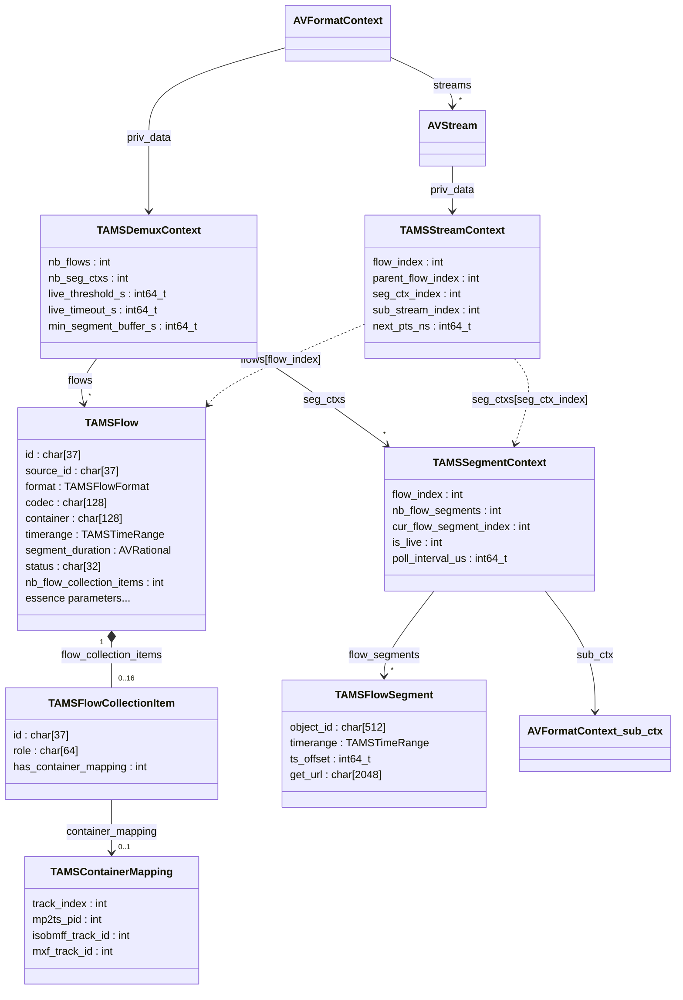
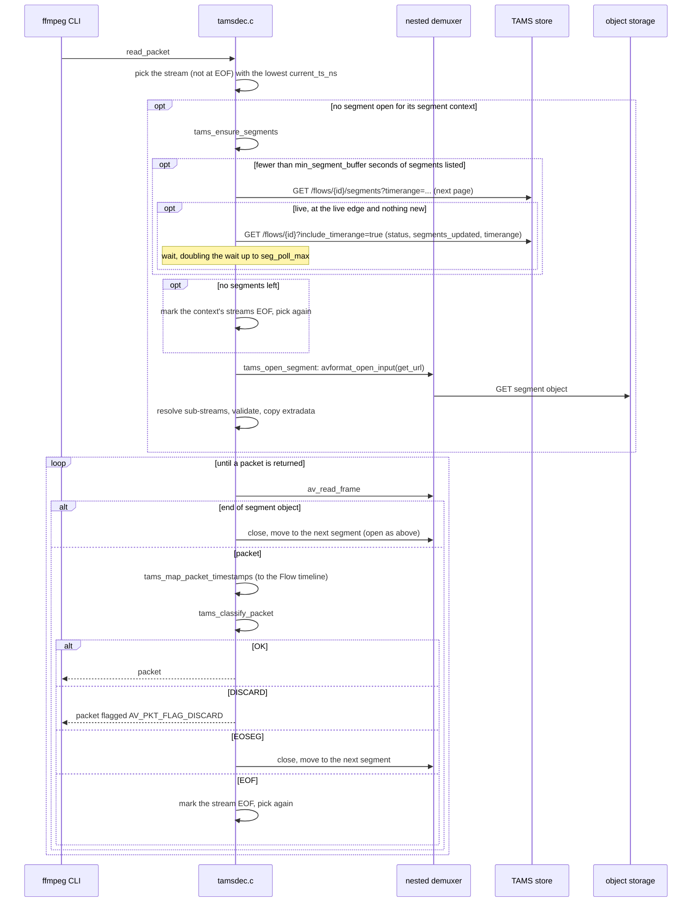
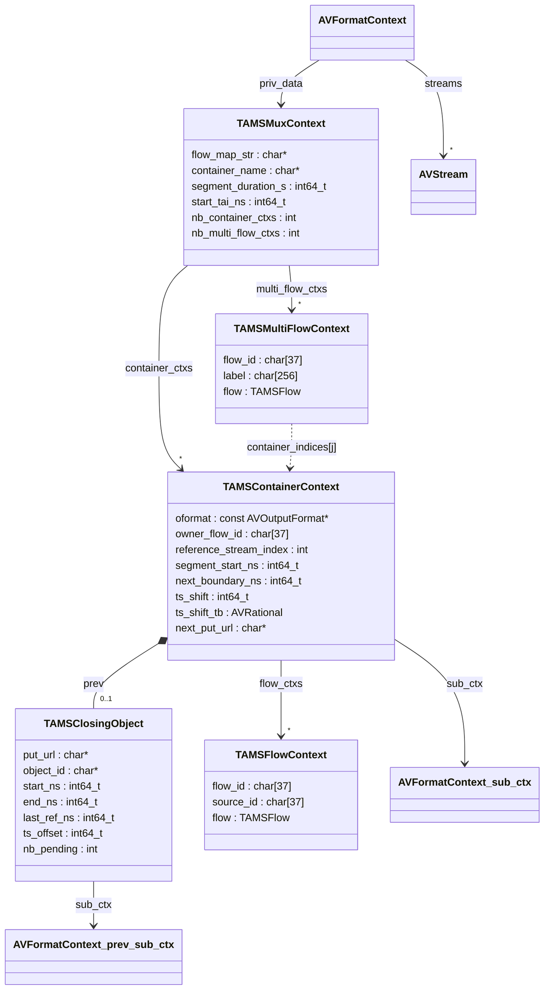
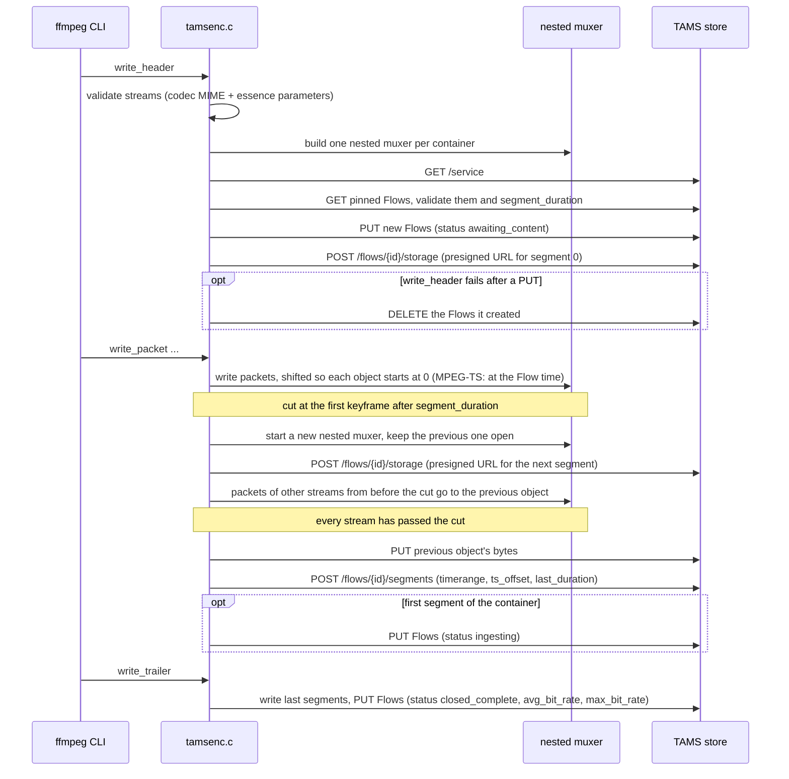
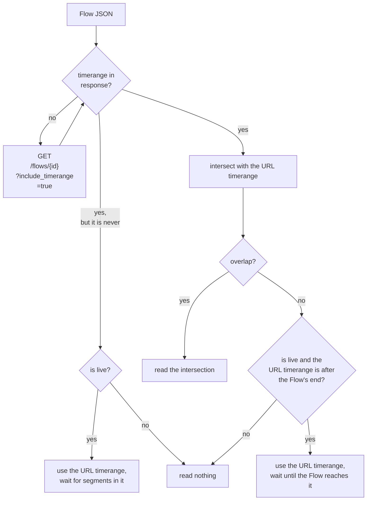

I have been working on adding support for [Time-Addressable Media Store](https://tams.org) (TAMS) to FFmpeg. This includes:

* a demuxer that reads Flows, Multi Flows and Sources from a TAMS store
* a muxer that writes one or more Flows or Multi-Flows to a TAMS store

Both live and non-live Flows are supported.

The work is available on the [`tams` branch](https://github.com/hootworks/FFmpeg/tree/tams) of an FFmpeg fork as a series of three patches which is being prepared to submit upstream.

<!--more-->

### TAMS Overview

TAMS is an open API specification, started by BBC R&D and now developed with a growing group of broadcasters and vendors.
It defines storage of media in the cloud as small time-addressable chunks rather than as monolithic files. The core concepts are:

* **Sources**: an abstract piece of content, e.g. "the camera 1 feed" or "episode 3"
* **Flows**: a concrete representation of a Source, e.g. "1080p H.264 at 8Mbps" or "stereo AAC". Flows can be video, audio, data, image or *multi* (a collection of other Flows)
* **Segments**: Media Objects (a small MPEG-TS, MP4, raw elementary stream etc.) registered against a Flow for a given timerange
* **Timeranges**: everything is addressed on a nanosecond TAI timeline, e.g. `[1792591960:585251000_1792591966:585251000)`

The API spec is here: [https://github.com/bbc/tams](https://github.com/bbc/tams).

Because media is stored as immutable, independently addressable segments on a shared timeline it enables:

* working with content while it is still being recorded
* making edits by reference instead of by copy
* sharing objects between Flows

However, a store is only useful if tools can get media in and out of it. Having TAMS supported natively in FFmpeg means anything which uses FFmpeg (ffmpeg, ffprobe, ffplay or any application built on libavformat) can read from and write to a TAMS store.

`\(^ヮ^)/`

Below is an overview of how the demuxer and muxer can be used followed by some implementation details and a collection of notes made along the way. Any corrections to my understanding of either FFmpeg behaviour or the TAMS specification or suggestions for improvements would be happily received!

### Demuxer Usage

The demuxer is selected automatically by probing when specifying a store URL as input.

The examples below assume a store at `$TAMS` and a bearer token in `$TOKEN`:

```shell script
TAMS=https://tams.example.com
AUTH="Authorization: Bearer $TOKEN"
```

_Inspect Flow_

ffprobe reports the Flow's streams and duration without downloading the whole Flow:

```shell script
ffprobe -headers "$AUTH" -show_streams -show_format "$TAMS/flows/<flowId>"
```

_Source To File_

Reading by `source_id` opens the Flows of the Source as the streams of one input, aligned on the shared TAI timeline. Here the first video and audio Flows are copied into a single MP4 without re-encoding:

```shell script
ffmpeg -headers "$AUTH" -i "$TAMS/flows?source_id=<sourceId>" \
  -map 0:v:0 -map 0:a:0 -c copy programme.mp4
```

_Timerange Clipping_

A `timerange` in the URL limits the read to that window. Only the segments which overlap it are fetched:

```shell script
ffmpeg -headers "$AUTH" \
  -i "$TAMS/flows/<flowId>?timerange=[1792591960:0_1792591990:0)" \
  -c copy clip.mp4
```

<small>**NOTE**: When the start falls part way through a GOP, the packets from the preceding keyframe are still read, as they are needed to decode the first frames. When using `-c copy` (as per the above example) the frames marked as discarded are still kept so the clip starts at that keyframe i.e. before the requested start. When re-encoding the frames are decoded and then discarded so the output starts exactly at the start of the timerange.</small>

_Seeking_

Standard `-ss` and `-t` work as for any seekable input. Here a 10 second proxy is made starting 2 minutes in:

```shell script
ffmpeg -headers "$AUTH" -ss 120 -t 10 -i "$TAMS/flows/<flowId>" \
  -vf scale=640:-2 -c:v libx264 -c:a aac proxy.mp4
```

_Live Playback_

A Flow which is still `ingesting` is followed as new segments are registered. Reading ends when the Flow is marked `closed_complete` or when no new segments arrive within `live_timeout`:

```shell script
ffplay -headers "$AUTH" "$TAMS/flows/<flowId>"
```

_Live Catchup_

Using a timerange that is open at the end starts at the specified point and then keeps following the live edge. Here a recording that is still in progress is transcoded from a given time onwards with a 30 second timeout to tolerate a stalled ingest:

```shell script
ffmpeg -headers "$AUTH" -live_timeout 30 \
  -i "$TAMS/flows?source_id=<sourceId>&timerange=[1792591960:0_)" \
  -c:v libx264 -c:a aac -f mpegts udp://239.0.0.1:1234
```

### Muxer Usage

The muxer is selected with `-f tams`, and its output URL is always the store's `/flows` endpoint. How the streams map to Flows is set via `-flow_map`. 

The examples below assume a store at `$TAMS` and a bearer token in `$TOKEN`:

```shell script
TAMS=https://tams.example.com
AUTH="Authorization: Bearer $TOKEN"
```

_One Flow Per Stream_

Without `-flow_map` each stream becomes its own new mono Flow registered under a new Source. A Flow's label and description are set from the stream's `title` and `comment` metadata, and any other metadata becomes a Flow tag:

```shell script
ffmpeg -i interview.mov -c:v libx264 -g 50 -c:a aac \
  -metadata:s:v:0 title="Interview camera 1" \
  -metadata:s:a:0 title="Interview audio" -metadata:s:a:0 language=eng \
  -headers "$AUTH" -f tams "$TAMS/flows"
```

<small>**NOTE**: By default essence is written into a raw elementary stream where possible. In the example above H.264 and AAC ADTS are used. A different format can be specified with `-container`.</small>

_Shared Container Multi Flow_

Mapping video and audio to one `flow=` token writes them into one container registered as a new multi Flow with a new video Flow and a new audio Flow in its `flow_collection`. The multi Flow's own label and tags are set on its `multi_flow=` token. A new Source is also registered:

```shell script
ffmpeg -i episode3.mxf -c:v libx264 -g 50 -c:a aac \
  -flow_map "flow=streams=0,1,multi_flow=0 multi_flow=0,label=Episode3,tags.series=Gardening" \
  -headers "$AUTH" -f tams "$TAMS/flows"
```

<small>**NOTE**: By default MP4 is used for multi Flow containers (see _MP4 Edit Lists_ further below). A different format can be specified with `-container`.</small>

_Live Ingest_

A live input can be recorded into the store as it arrives. The Flows are created as `awaiting_content`, set to `ingesting` once their first segment is registered and marked `closed_complete` when the muxer finishes. Here an SRT feed is recorded as MPEG-TS segments of 2 seconds:

```shell script
ffmpeg -i "srt://0.0.0.0:9000?mode=listener" \
  -c:v libx264 -g 50 -keyint_min 50 -c:a aac \
  -flow_map "flow=streams=0,1,multi_flow=0" \
  -container mpegts -segment_duration 2 \
  -headers "$AUTH" -f tams "$TAMS/flows"
```

<small>**NOTE**: Segments are cut on the first keyframe after `segment_duration` so the GOP settings should match this.</small>

_Ingest_

Muxing with stream copy:

```shell script
ffmpeg -i archive.mp4 -map 0:v -map 0:a -c copy \
  -flow_map "flow=streams=0,1,multi_flow=0" \
  -headers "$AUTH" -f tams "$TAMS/flows"
```

<small>**NOTE**: Segments can only start on a keyframe. With `-c copy` the input's GOP decides the segment length. Therefore a GOP longer than `segment_duration` gives longer segments.</small>

_Add Rendition To Existing Source_

Setting `source_id=` adds a new Flow to an existing Source. Here a Flow is read from the store, transcoded and written back as a lower bitrate proxy of the same Source. Setting `-start_timestamp` to the start of the original Flow's timerange places the proxy on the same part of the timeline as the original:

```shell script
START=$(curl -s -H "$AUTH" "$TAMS/flows/<flowId>?include_timerange=true" \
  | jq -r '.timerange | capture("^[\\[(]?(?<start>[0-9:]+)").start')
ffmpeg -headers "$AUTH" -i "$TAMS/flows/<flowId>" \
  -map 0:v -vf scale=640:-2 -c:v libx264 -b:v 1M -g 50 \
  -metadata:s:v:0 title="Proxy 360p" \
  -flow_map "flow=streams=0,source_id=<sourceId>" \
  -start_timestamp "$START" \
  -headers "$AUTH" -f tams "$TAMS/flows"
```

_Append To Flow_

Setting `id=` pins a stream to an existing Flow. In this case the stream's codec and essence parameters are checked against the Flow's existing details rather than overwriting them. Setting `-start_timestamp` to the end of the Flow's current timerange continues its timeline without a gap. Here a second recording is appended to an existing multi Flow, whose member Flows are found from the existing `flow_collection`:

```shell script
END=$(curl -s -H "$AUTH" "$TAMS/flows/<multiFlowId>?include_timerange=true" \
  | jq -r '.timerange | capture("_(?<end>[0-9:]+)").end')
ffmpeg -i part2.mp4 -c:v libx264 -g 50 -c:a aac \
  -flow_map "flow=streams=0,1,multi_flow=0 multi_flow=0,id=<multiFlowId>" \
  -start_timestamp "$END" \
  -headers "$AUTH" -f tams "$TAMS/flows"
```

### Implementation Overview

The code is on the `tams` branch here:

[https://github.com/hootworks/FFmpeg/tree/tams](https://github.com/hootworks/FFmpeg/tree/tams)

It is structured as three patch commits as would be submitted to the FFmpeg mailing list:

1. shared code for the TAMS data model and utility functions
2. the TAMS demuxer
3. the TAMS muxer

The main files are:

* `libavformat/tams.h` and `tams.c`: the TAMS data model, support for parsing and serialising Flows, Segments and storage allocations to and from JSON, timestamp and timerange handling, codec MIME mapping and HTTP requests with retry
* `libavformat/tamsdec.c`: the demuxer
* `libavformat/tamsenc.c`: the muxer
* `libavformat/tests/tams*.c`: unit tests, run as part of FATE
* `doc/demuxers.texi` and `doc/muxers.texi`: documentation

Corresponding FATE samples: [tams-fate-samples.tar.gz](/assets/download/tams-fate-samples.tar.gz)

### Demuxer Implementation

The demuxer accepts either a single Flow or multi Flow (`/flows/<id>`) or all the Flows of a Source (`/flows?source_id=<id>`). It is optional to specify a timerange. The demuxer creates one `AVStream` per video/audio/data Flow, expanding multi Flows into their members.

Each set of segments is read through a nested demuxer. A `TAMSSegmentContext` owns a child `AVFormatContext` which opens one segment at a time. Packet timestamps are mapped from the segment's container timeline onto the Flow timeline.

If several Flows share one container (a multi Flow with a `container_mapping`) then a single segment context is shared and packets are routed back to the right stream via track index, MPEG-TS PID, ISOBMFF track id or MXF track id. 

<small>**NOTE**: MXF track ids are parsed and matched but MXF is not yet supported. See _Not (Yet) Supported_ further below.</small>



The following shows the sequence of calls each time a packet is requested from the demuxer via `tams_read_packet`:



### Muxer Implementation

The muxer writes each input `AVStream` to a Flow. By default every stream gets its own mono Flow. The option `-flow_map` can be used to group streams into a multi Flow sharing one container or to pin streams to existing Flows and Sources.

Each segment is produced by a nested muxer (raw elementary stream, MP4, MOV, MPEG-TS or Matroska), uploaded to a presigned storage URL obtained from the store and then registered against the Flow with its timerange.



The following shows the overall behaviour of the muxer:



### Timeranges

Implementing support for Timeranges was more involved than expected. So I am recording some salient points below...

_Representation_

| Form | Meaning | FFmpeg JSON Output |
|------|---------|----------------------|
| `[5:0_10:0)` | from 5s up to (not including) 10s | `[5:0_10:0)` |
| `[5:0_)` | from 5s onwards | `[5:0_)` |
| `[5:0]` | instantaneous: exactly 5s | `[5:0_5:0]` |
| `_` | eternity: all time | `(_)` |
| `()` | never: the empty range | `()` |

_Never, Eternity and Unknown Timeranges_

`TAMSTimeRange` keeps a separate `never` flag because never `()` and eternity `_` both have no start and no end time. Without the flag they could not be told apart, although one contains no time at all and the other contains all time.

A Flow whose timerange is `()` has no segments yet, e.g. a live Flow which has just been created.

Multi Flows have two cases in which the timerange can be `()`:

* when each member has its own container: the segments are registered against the members so the multi Flow's own timerange is always `()`.
* when the members share a container: the segments are registered against the multi Flow so it is the members which are `()`. The demuxer uses the multi Flow's timerange for each Flow.

The spec only returns a Flow's timerange from `GET /flows/{id}` when `include_timerange=true` is given. The demuxer can't change the first request as FFmpeg opens the URL specified on the command line and probes the response before the demuxer is chosen. A Flow whose JSON has no timerange is therefore initially stored with no start or end, like eternity, and the demuxer requests it again with `include_timerange=true` to find out its real timerange.

_Intersecting Timeranges_

`ff_tams_timerange_intersect()` takes the later start and the earlier end of two timeranges, each with the inclusivity of the timerange it came from. When both starts (or both ends) are equal, that bound is inclusive only if both are. If the result is empty it returns `never`.

The intersection of the Flow's timerange and the URL's timerange is used to:

* give each stream its duration
* bound the segment requests (`/flows/{id}/segments?timerange=...`), so segments outside it are never listed or downloaded
* set where a stream ends. A live Flow's end is only how far it has been written so far, so a live read stops at the end of the URL's timerange.

_Timerange Responses_

A `timerange=` in the opened URL means different things to the store depending on the URL:

* on `/flows/{id}` it limits the timerange returned for the Flow.
* on `/flows?source_id=...` it filters which Flows are listed. A Flow is included if its timerange overlaps the requested one and the actual `timerange` returned for it is still the Flow's whole timerange, not just the overlap. The demuxer therefore intersects each listed Flow's timerange with the requested one itself.
* a multi Flow with independent members has its own timerange `()`, which never overlaps, so its members need to be asked for by `/flows/{id}`.

_Timerange Request Logic_

In the diagram below, whether a Flow "is live" or not is decided from its status (see _Flow Status_ further below).



### Segment Boundaries and Offsets

Implementing segment boundaries was _also_ more involved than expected. So I am recording more salient points below...

_Segment Timeranges Driven By Keyframes_

Segments can only start at a keyframe, so with x264's default GOP of 250 frames at 25 fps, a 2 second `segment_duration` really means 10 second segments. The muxer therefore registers each segment from its first keyframe up to the next cut, not the *planned* boundary.


_`ts_offset` Per Segment_

TAMS defines a segment's `ts_offset` as the value added to each container timestamp to put it on the Flow timeline.
The muxer ensures that the first segment of a Flow starts at the earliest packet of any stream.
This ensures that any audio priming packets stay negative. 
Every later segment starts at the video keyframe it was cut on.

Starting from the earliest packet matters when an input's audio begins before its first video frame, as it can with MPEG-TS or live inputs. For example, if the first video frame is at 0.066s and the audio starts at 0s, registering the first segment from the video frame, as `[0:66000000_...)`, would put the audio packets at 0, 0.021, 0.043 and 0.064s before it, and readers would discard them. The segment is registered from 0s instead.


The muxer sets the timestamps of every segment object following the first segment to be zero at the keyframe they are cut on. It sets `ts_offset` to that keyframe's position on the Flow timeline. lavf moves timestamps up when the first ones would be negative (B-frames, audio priming) and the muxer subtracts that shift from `ts_offset`. The exception is MPEG-TS, which follows the TAMS [MPEG-TS application note](https://github.com/bbc/tams/blob/main/docs/appnotes/0002-Timing-in-MPEG-TS.md): each PTS is the Flow time at 90 kHz modulo 2^33, and `ts_offset` is the time the 33-bit counter last rolled over. The muxer also turns off the MPEG-TS muxer's own mux delay which would otherwise be added to every timestamp.


_Audio Priming Samples_

Packets with negative timestamps are normally encoder priming e.g. the 1024 samples an AAC decoder outputs before the real audio. They stay before the start of the Flow where readers discard them. Therefore the first audible sample is at the start of the Flow. Where the priming ends part way through a packet (MP3, MP2, AC-3 and E-AC-3 encoders all do this), the demuxer keeps that packet and marks the part before the Flow start as skip samples so that decoding starts exactly at the Flow start. The same trim applies when a segment starts part way through an object e.g. in an edited Flow.
Only the first object holds priming, so the muxer writes every later object without declaring any. Otherwise Matroska's `CodecDelay`, or the MP3 Xing/LAME header from which a reader works out the decoder delay, would make the reader trim real audio from the start of every object.


_Absent `ts_offset` Workaround_

`ts_offset` is optional and assumed to be `0:0` when absent. If a segment omits it but its media timestamps lie well outside the segment's timerange (e.g. objects with timestamps starting near 0 registered against a TAI timerange, which is assumed to be caused by a writer error) the demuxer infers the offset from the first packet and logs a warning. Without this every packet would fall outside the segment.

_Segment Boundaries and Timeranges_

Segments start on keyframes, so a requested start usually falls part way through a segment. The packets before the start are still returned but flagged `AV_PKT_FLAG_DISCARD` because a decoder needs the preceding keyframe and the frames after it to decode the first frames in range. The decoder then drops the output of the discarded ones. Decoding `[40.0_40.5)` from a Flow with a single segment covering 39.74s to 40.70s therefore returns exactly 0.5s of frames. However using `-c copy` keeps the flagged packets so that the copy is still decodable and hence the timerange cut will not be accurate.

_Shared Container Segment Boundaries_

When video and audio share a container which is cut on a video keyframe, the audio packets just before the cut arrive after that keyframe, because packets are interleaved by decode time and the keyframe is decoded ahead of its display time. The muxer therefore keeps the previous object open after a cut and writes those packets to it, so every packet lies inside the timerange of the object that holds it. The previous object is uploaded once every stream has passed the cut.

Open-GOP leading pictures can't be moved to the previous object and other writers may not support moving packets to a previous segment at all.
The demuxer therefore does not discard packets which follow on from what has already been delivered in a previous segment despite being before the start of the new segment's timerange.
It also clears any discard flag set by the nested demuxer. For example an MP4 edit list marks the open-GOP leading pictures before an
object's first keyframe as discard. Within a Flow those pictures continue the previous segment so the demuxer decides which packets to discard only from the segment and Flow timeranges.

_MP4 Edit Lists_

MP4 objects are written as regular MP4 files with an edit list per track, not as fragmented MP4. Each object is built in memory and uploaded whole so there
is no need for then to be fragmented. The edit list records where each track really starts: the first video frame after the B-frame reordering delay, and the first audio sample after the AAC priming.

In FFmpeg the muxer writes an edit list when the first presented sample isn't at 0 (B-frame reordering, AAC priming) and the demuxer applies it i.e. both use the post-edit-list times.

_Independent Containers Per Segment_

An early implementation of the muxer kept a single nested muxer running and simply swapped its output buffer at each segment boundary. That worked for MPEG-TS but not for MP4 (where the `moov` only appears at the end) or raw formats whose headers only appear once. The muxer now restarts the nested muxer for every segment in the same way as the `segment` muxer.

_Zero-Based Segment Timestamps_

_Another_ early implementation of the muxer let the nested muxer keep the input's continuous timestamps, so that each segment object started where the previous one ended. It then registered the same `ts_offset` for every segment of a Flow. Only raw elementary streams, which have no timestamps of their own, restarted at zero with a `ts_offset` per segment.

That implementation relied on every reader honouring an object's non-zero starting timestamp, and it tied each object to the position on the timeline where it was first written, so an object re-used elsewhere in an edited Flow still carried those timestamps. Zero-based objects avoid both.

The current muxer implementation now starts every object after the first at zero and sets `ts_offset` per segment (except for MPEG-TS - see _`ts_offset` Per Segment_ above).
This fits `ts_offset` being set per segment and makes each object independent of its position on the timeline.

Segments written with continuous timestamps remain valid, as the demuxer applies each segment's own `ts_offset`, and a Flow can mix both kinds of segment.

_Raw Segment Parameter Sets_

The TAMS muxer declares global headers, as MP4 and Matroska need the codec's parameter sets when they write their own header. Because of this encoders only put the parameter sets in the stream's extradata. A raw elementary-stream segment has no header, so the muxer copies the extradata in front of every keyframe. This is only correct when the extradata is already in start-code form: when H.264 or HEVC is stream copied from MP4, it is in MP4's own `avcC`/`hvcC` form, and the raw muxer's own conversion filter already inserts the parameter sets.

### Further Implementation Details

_No JSON Library_

FFmpeg has no JSON parser dependency so the JSON handling is a small cursor-based parser built on `AVBPrint` covering just the TAMS schemas.

_Flow Status_

A reader can't know whether a Flow is still being written to just from its segments. TAMS 8.2 adds a Flow `status` which the muxer sets to `awaiting_content` until the first segment is registered, `ingesting` while writing and `closed_complete` when done. The demuxer uses this `status` value and falls back to timing heuristics (based on `segments_updated` and the observed segment length) for Flows without a `status` or whose writer has disappeared.

_Segment and Flow Properties_

Each segment is registered with its `last_duration` which is the time from the start of its last frame (video where there is video, otherwise audio) to the end of its timerange. When the muxer finishes it also sets each Flow's `avg_bit_rate` and `max_bit_rate` from the sizes and durations of the segments it wrote.

_Credentials_

Authentication uses standard FFmpeg `-headers` and those headers are only replayed to the store's host, never to the presigned storage URLs.

### Not (Yet) Supported

* Flows using separate initialisation segments (`init_object`, new in 8.2). These are currently rejected with a clear error
* Demuxing from or muxing to MXF.
* Image Flows.
* Obtaining or refreshing OAuth tokens.
* Ogg, Vorbis, Opus and FLAC are not supported.

### Known Limitations

* Raw video or PCM segments with no container are not supported. Based on the standard ffmpeg design the demuxer detects segment formats by probing rather than from the Flow's specified `container`. Because such uncompressed data Sources have nothing to probe they cannot currently be handled. For this reason the muxer's default for such data is Matroska (raw video) or MP4 (PCM).
* Seeking with `-ss` in Flows stored as raw H.264 or HEVC elementary streams is only accurate to a segment boundary. These streams carry no timestamps so ffmpeg cannot discard the frames between the start of the segment and the seek point. For the same reason a Flow can only re-use such Media Objects whole: a segment using part of an object or a timerange starting part way through a segment returns every frame of the object.
* The demuxer feeds every segment to one decoder so that the decoder carries its state from one segment to the next. This gives seamless playback across contiguous segments.
But where there are no earlier packets to prime an audio decoder (e.g. a read starting exactly on a segment boundary part way through a Flow or at an edit in an edited Flow) its first output differs slightly from a continuous decode
(one frame for AAC, longer for some codecs).
A read starting inside a segment is primed by the discarded packets before the start and is not affected.
Video is not affected, as every segment starts with a keyframe.
* The muxer only requests presigned upload URLs from the store, and the demuxer prefers a segment's presigned `get_urls`. The store's credentials (`-headers`) are only sent to the store's own host. Therefore a segment which only has **non-presigned** URLs on another host can only be read if that storage allows anonymous access.
* The demuxer skips, with a warning, any video or audio Flow whose `codec` is not a codec MIME type it knows, so the other Flows of a Source can still be read.
* Strings in the store's JSON responses are read as UTF-8 and non-ASCII characters sent as literal UTF-8 are kept. Characters sent as `\uXXXX` escapes are replaced with `?`. This mainly affects labels, descriptions and tags.

### Testing

The patches include unit tests for the JSON parsing, timestamp and timerange handling, the demuxer's segment, timestamp and URL timerange logic and the muxer's `-flow_map` parsing. 

FATE tests also include demuxing TAMS samples.
The FATE samples ([tams-fate-samples.tar.gz](/assets/download/tams-fate-samples.tar.gz)) are store responses and segment objects saved as local files. A file URL input is read as a complete response: no query strings are added, a single page of segments is expected and Flows are not re-fetched.

Manual testing has been performed against a hosted instance of the AWS open-source TAMS implementation (API 8.2):

* Muxing a 6 second test source with each supported video and audio codec and then demuxing by Flow and by Source, checking every frame is present and timestamps are continuous. 
* The same was also tested using stream copy from MP4 and MPEG-TS inputs.
* Various scenarios for each container type including multi Flows (shared and independent), pinning to existing Flows, Sources and multi Flows or adding new ones.
* Appending a second recording to an existing timeline without a gap.
* Timerange requests and seeking.
* End-to-end live scenarios involving muxing a 720p test source in real time while reading it back concurrently by Flow and by Source. Tested with different GOP sizes, containers and codecs. Scenarios such as joining late and killing the muxer while running were also covered.
* Edited Flows built on the store with segments re-using Media Objects including whole objects at a new position on the timeline and parts of objects.
* Reading existing third-party content from the store.
* Fuzzing the demuxer with damaged JSON.

### Not (Yet) Tested

* Long running live flows.
* Stores other than the AWS implementation.

### Next Steps

The next step is to submit the patches to the FFmpeg development mailing list for review. If you are using TAMS in any way and require assistance, please [make contact](/contact/).